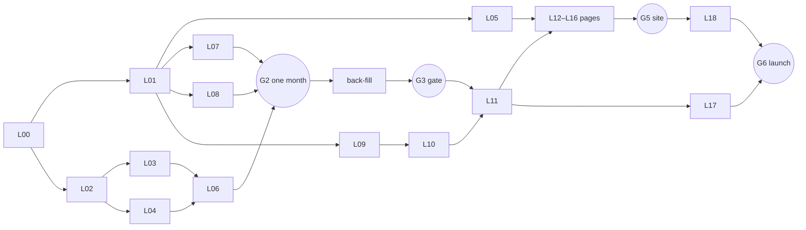

# Development plan: NYC Ride Market v1

22 Oct 2026 · Integrator space (project root) · Implements SPEC.md v1.0

SPEC.md says **what** to build and wins on any detail. This file says **who builds what, in what order, and how the pieces meet**. The work is split into 19 lanes. One agent runs each lane in its own space, owns a fixed set of files, and works from a brief in `docs/lanes/`.

---

## 1. How the lanes work

**Spaces.** One agent per lane. Recommended: each lane in its own git worktree on branch `lane/LNN-name` (the desktop app's worktree sessions do this for you). The project root is the **integrator space**. It owns the shared files, merges lanes, runs the real-data jobs and holds the gates.

**Kickoff prompt.** Paste into a new agent session and change the lane:

> You are lane L06 (Clean) on the NYC Ride Market project. Read CLAUDE.md, SPEC.md, docs/development-plan.md §1–§5, then docs/lanes/L06-clean.md. Write only the files your lane file lists under "Owns". If you need any other file changed, stop and record it under "Blocked" in your lane's status log. Build against the contracts and fixtures; don't wait for upstream lanes. Run `make test` before every commit. When done, fill in the hand-off in your status log.

**Rules on top of CLAUDE.md**

1. **Ownership.** A lane writes only its "Owns" list. The integrator owns SPEC.md, CLAUDE.md, Makefile, pyproject.toml, `site/package.json`, `.gitignore`, `pipeline/common.py`, `docs/decisions.md` and this file. Contract files (`contracts/`, `tests/factories.py`, `tests/contract_check.py`) change only through the integrator.
2. **Contracts first.** Build against SPEC §4–§6, §9.2 and `contracts/`. Use `tests/factories.py` and mock site data rather than waiting for upstream outputs.
3. **One shared data directory.** Every space sets `NYC_DATA_DIR` to the main checkout's `data/`, so raw files (about 17 GB for 2024-01 to 2026-08, estimated) are downloaded once. A lane writes only its own step's folder (`raw/` ingest, `clean/` clean, `agg/` aggregate); experiments go in `data/scratch/LNN/`. Full back-fills and real validation runs happen only in the integrator space.
4. **Blocked protocol.** If you need a decision, a contract change, a new dependency or an edit outside your files, write it under "Blocked" in your status log and stop that thread of work. The integrator resolves it. Any change to a locked decision goes in `docs/decisions.md`.
5. **Hand-off.** A lane is done when every "Done when" item is checked, `make test` is green and the status-log hand-off is filled in (what was built, how it was checked, known limits, follow-ups).
6. **Mock data never ships.** Mock site files carry `"as_of_month": "MOCK"`. Publish and deploy refuse them.
7. **Same-folder mode.** If agents share one checkout instead of worktrees, they don't commit. The integrator commits each lane's files separately.

---

## 2. Lanes

The integrator keeps the Status column current.

| ID | Lane | Owns (main paths) | Wave | Starts when | Answers | Status |
|---|---|---|---|---|---|---|
| [L00](lanes/L00-scaffold.md) | Scaffold | Makefile, stubs, CI, `pipeline/common.py` | 0 | now (after D14) | — | done 23 Oct |
| [L01](lanes/L01-contracts.md) | Contracts | `contracts/`, `tests/factories.py` | 0 | L00 merged; D7–D10, D13 answered | all | done 24 Oct |
| [L02](lanes/L02-ingest.md) | Ingest | `pipeline/ingest.py`, `config/sources.yaml` | 1 | L00 merged | — | done 24 Oct (merged) |
| [L03](lanes/L03-schema.md) | Schema discovery and map | `pipeline/discover.py`, `pipeline/schema_map.py`, `config/schema_map.yaml` | 1 | L02 can fetch a month (or D11 agreed) | — | done 24 Oct (merged) |
| [L04](lanes/L04-zones.md) | Zones, CBD list, airports, map | `pipeline/zones.py`, `config/cbd_zones.csv`, `config/airports.csv` | 1 | `make ref` works | Q2, Q9 | done 24 Oct (merged) |
| [L05](lanes/L05-site-foundation.md) | Site foundation | `site/observablehq.config.js`, `site/src/components/`, styles | 1 | L01 approved | — | done 24 Oct (merged) |
| [L06](lanes/L06-clean.md) | Clean | `pipeline/clean.py`, `sql/clean/` | 2 | L03 map + L04 draft | — | not started |
| [L07](lanes/L07-aggregate.md) | Aggregate | `pipeline/aggregate.py`, `sql/agg/` | 2 | L01 approved | — | built on fixtures, merged 24 Oct (D23 included); real run at G2 |
| [L08](lanes/L08-validate.md) | Validation gate | `pipeline/validate.py`, `sql/validate/` | 2 | L01 approved | — | built on fixtures, merged 24 Oct; real run at G2 |
| [L09](lanes/L09-metrics.md) | Metrics library | `sql/metrics/` (all but L10's), `pipeline/metrics.py` | 2 | L01 approved | Q1, Q4–Q15 | built on fixtures, merged 24 Oct; real run at G2 |
| [L10](lanes/L10-policy-studies.md) | Policy studies | `sql/metrics/cp_*.sql`, `pay_event.sql`, `pipeline/studies.py` | 3 | L09 runner exists | Q2, Q3, Q6 | done: write-ups from the G3 aggregates merged 27 Oct (`daa0739`); pay-rise narrative being sharpened with the TLC rule's terms |
| [L11](lanes/L11-publish.md) | Publish and findings | `pipeline/publish.py`, `pipeline/findings.py`, `site/src/data/` | 3 | L09 runner exists | all | done: merged 27 Oct (`84824ca`); a real validated publish writes 278 files within budget |
| [L12](lanes/L12-pages-home-methods.md) | Pages: Home + Methods | `index.md`, `methods.md` | 4 | L05 done | home | running in the cloud since 27 Oct; reports by draft PR from `lane/L12-…` |
| [L13](lanes/L13-pages-companies.md) | Pages: Companies | `companies/[company].md` | 4 | L05 done | Q4, Q5, Q11–Q13 | running in the cloud since 27 Oct; reports by draft PR from `lane/L13-…` |
| [L14](lanes/L14-pages-zones.md) | Pages: Zones | `zones/[zone].md`, `zones/index.md` | 4 | L05 done | Q1, Q8, Q10 | running in the cloud since 27 Oct; reports by draft PR from `lane/L14-…` |
| [L15](lanes/L15-pages-congestion-drivers.md) | Pages: Congestion + Drivers | `congestion-pricing.md`, `drivers.md` | 4 | L05 done | Q2, Q3, Q5, Q6, Q14, Q15 | running in the cloud since 27 Oct; reports by draft PR from `lane/L15-…` |
| [L16](lanes/L16-pages-airports-prices.md) | Pages: Airports + Prices | `airports.md`, `prices.md` | 4 | L05 done | Q7, Q9 | running in the cloud since 27 Oct; reports by draft PR from `lane/L16-…` |
| [L17](lanes/L17-refresh-deploy.md) | Refresh and deploy | `.github/workflows/refresh.yml`, release scripts | 4 | L11 writes real data; GitHub repo exists | — | not started |
| [L18](lanes/L18-launch-review.md) | Launch review | `reports/launch_review.md` | 5 | G5 | all | not started |

---

## 3. Schedule

| Wave | Dates (2026) | SPEC phase | Lanes running | Integrator does | Ends with |
|---|---|---|---|---|---|
| 0 | 23–25 Oct | before 1 | L00, then L01 | settles §7 decisions; `git init` | contracts approved |
| 1 | 26 Oct – 1 Nov | 1 | L02, L03, L04, L05 | merges; real `make ingest` for 2024-01 and 2026-08 | **G1** 1 Nov |
| 2 | 2 – 15 Nov | 2 | L06, L07, L08, L09 (L05 finishing) | one-month end-to-end run; back-fill 2024-01 → 2026-08; `make validate` | **G2** ~8 Nov, **G3** 15 Nov |
| 3 | 9 – 29 Nov | 3 | L10, L11 | metrics on real aggregates; reviews Q1–Q15 findings | **G4** 29 Nov |
| 4 | 16 Nov – 10 Dec | 4 | L12–L16 (on mocks first, real data once L11 publishes), L17 | merges pages; budget checks | **G5** 10 Dec |
| 5 | 7 – 14 Dec | 5 | L18; owning lanes fix what it finds | first full refresh run; deploy | **G6** v1 live 14 Dec |

SPEC starts the site phase on 23 Nov. Page lanes may start a week earlier on mock data; that changes no deliverable. At most four or five agents run at once.

**Critical path:** L00 → L02 → L03 → L06 → G2 → back-fill (96 files, network-bound) → G3 → L11 on real data → pages switch from mocks → L18 → launch. Everything else runs beside it on fixtures and mocks. Start the back-fill the day G2 passes.

---

## 4. Contracts between lanes

| Contract | Defined in | Producer | Consumers |
|---|---|---|---|
| Make targets and CLI signatures | Makefile, stub modules | L00 | all, L17 |
| Paths, config loading, `NYC_DATA_DIR` | `pipeline/common.py` | L00 | every pipeline lane |
| Raw → unified column mapping | `config/schema_map.yaml` + `pipeline/schema_map.py` | L03 | L06, L08 |
| Zone lists | `config/cbd_zones.csv`, `config/airports.csv`, `pipeline/zones.py` helper | L04 | L06, L07, L08, L10 |
| Clean trips | SPEC §4 schema at `data/clean/mode=/month=/` | L06 | L07 |
| Aggregate tables | SPEC §5 (+ agreed §7 changes), built by `tests/factories.py` | L07 | L08, L09, L10 |
| Metric outputs | `contracts/metrics.md` | L09, L10 | L11 |
| Validation summary | `data/agg/validation_summary.json` (shape in `contracts/README.md`) | L08 | L11, L17 |
| Site data files | `contracts/site/*.example.json` | L11 | L05, L12–L16 |
| Route → files, methods anchors | `contracts/site/pages.yaml` | L01 | L05, L11, L12–L16 |
| Chart and tile components | `site/src/components/` | L05 | L12–L16 |
| Zone geometry | `data/ref/taxi_zones.simplified.geojson` | L04 | L11 copies it; L14 draws it |

To change a contract: the lane asks under "Blocked"; the integrator updates the contract and factories, then notes the change in each affected lane's status log.

---

## 5. Gates

All gate checks run in the integrator space. G1, G3, G4, G5 and G6 are SPEC §11's definitions of done; when one passes, the integrator says so and lists what was checked.

| Gate | Target | Passes when |
|---|---|---|
| G1 | 1 Nov | `make ingest` works for any month; `reports/schema_discovery.md` covers 2024-01 → 2026-08; every raw column mapped or ignored; `cbd_zones.csv` draft + `reports/cbd_zones.md`; airports confirmed |
| G2 | ~8 Nov (passed 25 Oct, see gate log) | `make month MONTH=2025-03` runs end to end on real data: rows in = rows out; every aggregate table built; `make validate` runs and that month ties out within ±2%; `python -m pipeline.metrics --all` runs |
| G3 | 15 Nov (passed 26 Oct, see gate log) | `make backfill FROM=2024-01 TO=2026-08` clean; **`make validate` passes**; pytest covers the cleaning flags and every metric |
| G4 | 29 Nov | every SPEC §6 metric has output; congestion and pay-rise studies written up; Q1–Q15 each has a generated finding; `make publish` writes every contract file |
| G5 | 10 Dec | every route builds, including 263 zone pages; data budgets pass; palette and dark mode in place |
| G6 | 14 Dec | methods page complete; L18 review closed; phone layout checked; refresh workflow ran once end to end; v1 deployed |

### Gate log

- **D28 and D29 merged and re-run on the real data, 30 Oct 2026.** L07 (`wav_trips`, `1eb6554`), L09 (`wav_service`, `c815dda`) and L11 (findings fixes `dbbb831`, D28/D29 `148660d`) were test-merged onto `integrator/d28-d29` (484 passed, site built) and merged into `main` as `22c5ddf`; L10's D28 wording went in as `7046078`.
  - `pipeline.aggregate` re-ran all 32 months from the clean files in 149 s. `make validate` passes as at G3 (all five checks), and `pipeline.metrics --all` exits 0.
  - `pipeline.publish` wrote 278 files with `validated: true`; every file passes its contract and every route its budget. Not committed: `site/src/data/` waits for the G4 review.
  - Q11 on real data: in Aug 2026 Uber completed 43,600 WAV-requested trips and Lyft 24,400; 12.0% of Uber's trips and 6.4% of Lyft's ran in a WAV.
  - Q6 on real data, net of 2024 across W31: pay per minute with a passenger −0.9%, pay per mile −1.2%, base fare per mile −2.2%.
- **L10 and L11 merged, 27 Oct 2026.** The test-merge of both onto `main` passed `make test` (473 passed, site built); merged as `daa0739` and `84824ca`, CI green.
  - L11's real publish (278 files, `validated: true`) passes every contract once the zone-map check accepts MultiPolygons: 12 real zones are MultiPolygons. The checker now checks a geometry down to its type, and the mock splits zone 2 (`bc1ef2c`).
  - **D28 and D29 accepted by the user, 27 Oct** (`56afd38`): 1 Aug 2025 is a new minimum-pay rule (per-mile floor down, per-minute floor up) with TLC's 1 Mar 2025 CPI-W step as a second event; Q11 reports completed WAV-requested trips and the share of trips in a WAV. Contracts on `integrator/d28-d29` (`ccf8df7`); L07 (`wav_trips`), L09 (`wav_service`), L10 (wording) and L11 (events, Q6, Q11) are implementing; then real `make aggregate` for 32 months and a re-publish.
- **G3, 26 Oct 2026 — passed** (after D26 and D27 merged to `main` as `ac095b4`). `make backfill FROM=2024-01 TO=2026-08` re-ran all 32 months. A DNS outage and the Mac's idle sleep broke 2025-08 twice; it was resumed under `caffeinate -i` and finished in 4 minutes. Rows match at every stage in all 32 months, and no clean row is flagged for zone 265 alone (D26).
  - `make validate` **exits 0**, all five checks pass:
    - **tie-out:** all 31 FHVHV months within ±2%, plus 2026-06 excepted (D27). Yellow (10 months outside) and green (19 outside) are reported, not gated.
    - **quality:** all 128 month × mode rows ≥ 85% (D26); 8 drift months listed, yellow's 2025-05 → 2025-11 fare episode and Lyft 2025-08.
    - **CBD list:** core 98.92%.
    - **schema:** 96 files.
    - **fees:** 100%.
  - `python -m pipeline.metrics --all`: 24 metrics, exit 0.
  - `reports/validation.md` committed.
  - **SPEC §11 phase 2 is done** as of the L10 merge (`5b07c37`, 26 Oct): pytest covers the cleaning flags and all 29 metrics (396 tests), and all five L10 metrics run on the real aggregates (`--all` exit 0).
- **G3, back-fill 26 Oct 2026 — not passed.** `make backfill FROM=2024-01 TO=2026-08` ran all 32 months in about 10 minutes (exit 0). Rows match at every stage in every month; clean files take 19 GB and aggregates 215 MB.
  - `make validate`:
    - **pass:** CBD list (core 98.92%), schema, fees.
    - **quality fails:** 57 of 128 month × mode rows below 95%. Green is below in all 32 months, yellow in 21, Lyft in 4, Uber in none.
    - **tie-out fails:** 27 of 96 month × class rows. FHVHV is +0.00% except 2026-06 (−2.14%: TLC's figure exceeds the rows in its own unchanged file). Green runs +2.1% to +3.0% with all vendors from 2024-12. D25's vendor-6 exclusion over-corrects it to −4% to −10% from 2025-07, because vendor 6 matched the 2025-03 gap by coincidence. Yellow drifts to +4% through 2026-05, then falls to about 0 from 2026-06.
  - Both rules wait on the user.
- **G2, re-run 25 Oct 2026 — passed** (after D24 and D25 merged to `main` as `1ed9094`). `make month MONTH=2025-03`: 20 s, peak memory about 5.2 GB. Rows match at every stage for fhvhv, yellow and green, all ten aggregate tables were written, and the raw files were deleted.
  - `make validate`, 2025-03:
    - **tie-out passes for all three classes:** FHVHV +0.00%; green −0.05% (1,222 vendor-6 records left out); yellow +1.16% (334 left out).
    - **also passing:** CBD list (core 98.74%), schema (96 files; the CloudFront rate limit cost a 3-minute wait), fees (100%).
    - **still failing:** quality, yellow 91.68% and green 92.55% below 95%. That's deferred to G3 by the user; G3 fails on it unless the rule is decided.
  - `python -m pipeline.metrics --all`: 24 metrics, exit 0. WAV match: Uber 100%, Lyft 99.98%. Shared match: Uber 52.3%; Lyft has no requests (NULL).
  - `reports/schema_discovery.md` was regenerated (lists `vendor_id`). The partial `reports/validation.md` isn't committed.
- **G2, 25 Oct 2026 — not passed yet.** `make month MONTH=2025-03` ran end to end in 23 s, peak memory about 5 GB. Rows match at every stage: manifest = clean = `agg_zone_hour.trips_all` = `agg_quality_month.rows` for fhvhv (20,536,879), yellow (4,145,257) and green (51,539). All nine aggregate tables were written, and the raw files were deleted.
  - `make validate` on 2025-03:
    - **pass:** CBD list (core 98.74%; wide 96.06%, reported), schema (96 files), fees (100% exact).
    - **tie-out:** FHVHV +0.00%, yellow +1.17%, **green +2.37% fail**. Green's gap is TLC not counting VendorID 6 records (1,222 trips); without them green is −0.05%.
    - **quality:** yellow 91.68% and green 92.55% are below 95%. That rule is deferred until the back-fill.
  - `python -m pipeline.metrics --all`: all 24 L09 metrics run, exit 0. **WAV and shared match rates are wrong (>1)**: `wav_match` counts every trip in an accessible vehicle, not only those that requested one.
  - `reports/validation.md` from this partial run isn't committed (L08: commit at G3).

---

## 6. Integrator checklist (this space)

- Before Wave 1: settle §7 with the user (done 23 Oct); run L00 (done 23 Oct) and L01 (done 24 Oct; contracts and D15–D18 approved). Repo: https://github.com/aagamshah15/nyc-ride-market (public); Pages: https://aagamshah15.github.io/nyc-ride-market/ (source GitHub Actions, deploys from `main` only).
- Merge order: L00 → L01 → L02, L04, L05 → L03 → L06 → L07 → L08, L09 → L10 → L11 → pages → L17 → L18.
- **Standing approval (user, 27 Oct 2026):** the integrator merges a lane into `main` and pushes once its test-merge passes `make test`, without asking each time. Any SPEC change, decision or tolerance change still goes to the user first.
- Run the real-data jobs: the G2 month, the back-fill, `make validate`, `make publish`.
- Route each validation failure to the lane that owns the cause. Never widen a tolerance without asking the user.
- Keep the §2 Status column current; record decision changes in `docs/decisions.md`.

---

## 7. Decisions needed before the lanes that hit them

These are gaps found in SPEC.md while planning. Numbering continues from SPEC §0 (D1–D6). **All eight recommendations were accepted on 23 Oct 2026 and are recorded in [docs/decisions.md](decisions.md), which is the authoritative wording.**

| # | Gap | Why it matters | Recommendation | Blocks |
|---|---|---|---|---|
| D7 | `agg_week_cbd` is keyed by ISO week but rebuilt one month at a time | ISO weeks straddle months, so "delete and rewrite that month's rows" can't find a month's share of a week | Add `month` (source-file month) to its grain; metrics sum over it | L01, L07, L10 |
| D8 | The CBD-list and fee checks (SPEC §7.2, §8) need trip-level data, but the refresh job restores only aggregates | Those checks can't run in CI, or for months whose clean files are gone | Add two small QA tables: `agg_cbd_pairs` (month × mode × pu_zone × do_zone: `trips_all`, `trips_cbd_fee`, 2025 on) and `agg_fee_values` (month × mode × cbd_fee: `trips`) | L01, L07, L08 |
| D9 | SPEC §7.3 asks for results with and without borderline zones | `cbd_group` is fixed when the aggregate is built | Mark borderline zones in `cbd_zones.csv`; add `zone_list ∈ {core, wide}` to `agg_week_cbd` | L04, L06, L07, L10 |
| D10 | Tiles need "median fare per mile" (company, prices) and "median fare to Manhattan" (airports) | Only per-zone percentiles exist; `agg_airport` stores sums, so no median is possible | Add a city-wide row (`pu_zone = 0`) per mode × month to `agg_zone_month_dist`; the airport tile shows mean fare per trip (ratio of sums), labelled as a mean | L01, L07, L09 |
| D11 | Schema discovery must DESCRIBE 96 files (about 17 GB) in Phase 1 | Downloading everything before the pipeline exists is slow and repeats the back-fill | Let `discover.py` read Parquet footers over HTTP (DuckDB `httpfs`, footer only). SPEC §2 says httpfs isn't needed, so this is a change | L03 |
| D12 | ISO week 2025-W01 (30 Dec – 5 Jan) has one day of pricing; 2025-W31 (28 Jul – 3 Aug) straddles the pay rise | Mixed weeks blur both estimates | Start the congestion effect at 2025-W02; mark W31 as a transition week in the event study | L10 |
| D13 | `zones/index.json` has no page in SPEC §9.1 | The city-wide zone maps (Q1, Q10) need a home | Add a `/zones` route: maps + searchable table linking to zone pages | L01, L05, L14 |
| D14 | The folder name has spaces, it isn't a git repo, and there's no GitHub remote | Make and shell scripts break on spaces; worktrees need git; Pages needs a repo | `git init` here; Makefile uses relative paths only; the user creates the GitHub repo and enables Pages | L00, L17 |

Already settled in SPEC's favour, no action needed: the brief's four aggregate tables (SPEC has seven); the brief's 2019–2023 back-fill in Phase 2 (SPEC moves it to Phase 6); the brief's volatility "by zone and hour" (SPEC uses zone × month).

---

## 8. Multi-agent risks

| Risk | Guard |
|---|---|
| Two agents edit the same file | Ownership lists; integrator-owned shared files; worktrees |
| Producer and consumer drift apart | Contracts change only via the integrator; structural tests against `contracts/` examples |
| Lanes pass on fixtures but fail on real data | G2 one-month end-to-end run before the back-fill |
| Raw data downloaded once per worktree | Shared `NYC_DATA_DIR` |
| Two processes rewrite `data/agg/` at once | Only the integrator runs real `make month` / `make backfill`; lane tests use temp dirs |
| Pages recompute metrics or hard-code numbers | CLAUDE.md rules; L18 greps page markdown for digits and `site/src` for colours outside `palette.js` |
| Mock data deployed | `as_of_month: "MOCK"` refused by publish and by the deploy guard |
| TLC revises a recent month | Proposed for L17: compare the last three months' size and ETag with the manifest and report changes (not in SPEC; integrator decides) |

---

## 9. After launch: L19 back-fill (Jan 2027)

Not briefed yet; the brief is written after G6. Scope: discovery for 2019-02 → 2023-12; extend `schema_map.yaml` year ranges (older files lack some columns); process and validate; extend the long-run share charts and the 2019 → 2026 zone change maps. With 2023 data in hand, add a placebo check for the congestion estimate (2024 vs 2023, same weeks).
